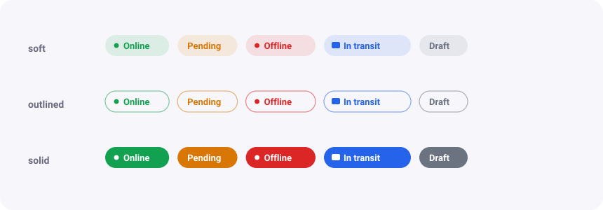

# status_badge_chip

[](https://pub.dev/packages/status_badge_chip)
[](https://github.com/senkop/status_badge_chip/actions/workflows/ci.yml)
[](LICENSE)

Status badges for tables, lists and cards. No dependencies.

- Five statuses: success, warning, error, info, neutral
- Soft, outlined and solid styles
- Optional dot (with a "live" pulse) or icon
- Dense size for tables
- Screen readers hear the status too



## Install

```bash
flutter pub add status_badge_chip
```

## Usage

```dart
import 'package:status_badge_chip/status_badge_chip.dart';

StatusBadge('Online', status: BadgeStatus.success, dot: true, pulse: true)
StatusBadge('Overdue', status: BadgeStatus.error, variant: BadgeVariant.solid)
StatusBadge('In transit', status: BadgeStatus.info, icon: Icons.local_shipping)
```

## Example

```bash
cd example
flutter create .
flutter run -d chrome
```

## License

MIT
